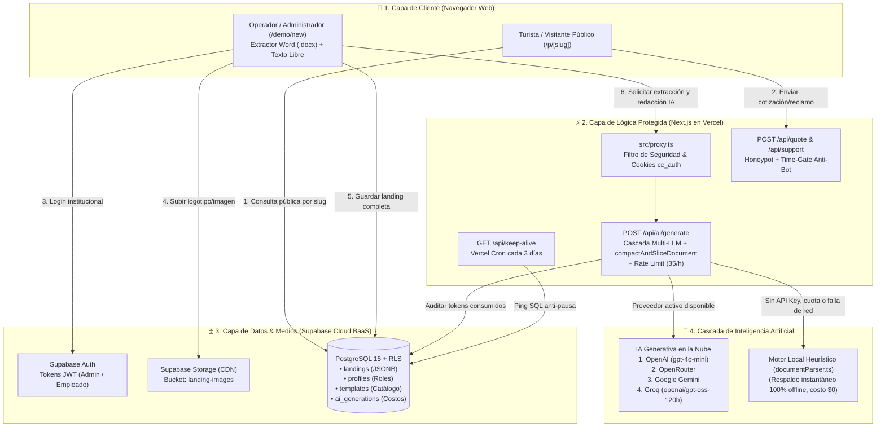
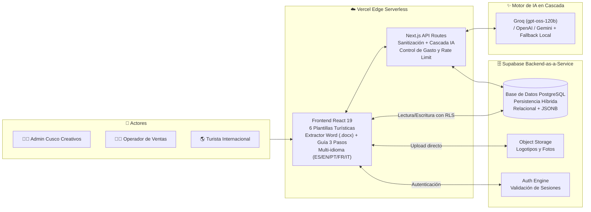
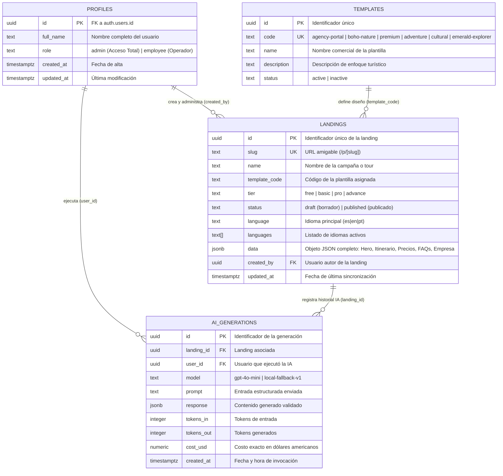
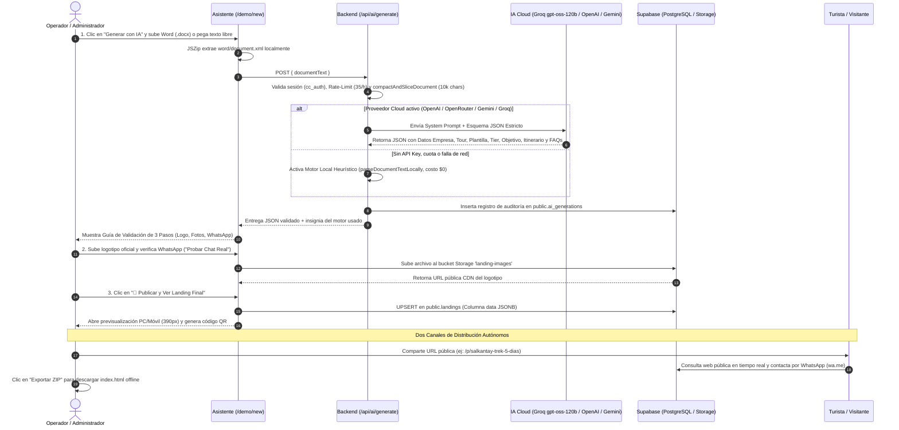
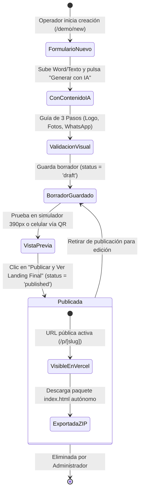
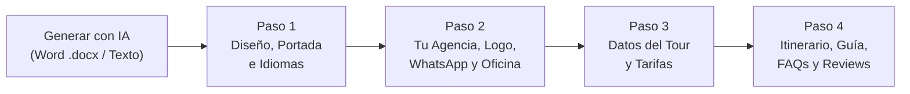

# 📘 DOCUMENTACIÓN DE TESIS: ARQUITECTURA, MEDICIÓN DE RESULTADOS Y MANUAL DE USUARIO

> **Proyecto:** Sistema Web Generador Automatizado de Landing Pages Turísticas de Alta Conversión con Inteligencia Artificial  
> **Área:** Ingeniería de Software / Comercio Electrónico Turístico  
> **Stack Oficial:** Next.js 16 (App Router) + TypeScript + Tailwind CSS + Supabase (PostgreSQL 15, Auth, RLS, Storage) + IA Multi-Proveedor en Cascada (Groq `openai/gpt-oss-120b`, OpenAI `gpt-4o-mini`, OpenRouter, Gemini & Motor Local) + Vercel Serverless Cloud.

---

## 1. Diagramas de Arquitectura y Mapas de Funcionamiento

### 1.1 Mapa de Flujo de Datos y Peticiones (Frontend ➔ Vercel ➔ Supabase ➔ IA Multi-Proveedor)
Este mapa explica claramente cómo se dividen las peticiones según su nivel de seguridad: las consultas directas y subida de archivos van a Supabase con permisos RLS, mientras que las operaciones con credenciales privadas pasan por las APIs de Next.js en Vercel.

---

### 1.2 Arquitectura General Cloud-Native Serverless
Estructura desacoplada que permite costo cero en fase experimental y alta escalabilidad horizontal para soportar miles de visitas concurrentes sin caídas de servidor.

---

### 1.3 Modelo Entidad-Relación de Base de Datos (Supabase PostgreSQL)
Ilustra el diseño de datos relacional complementado con la columna `data` en formato `JSONB`, la cual almacena la estructura visual y de contenidos completa de cada landing page.

---

### 1.4 Diagrama de Secuencia: Flujo de Ingesta Word/Texto, IA y Publicación
Muestra la interacción paso a paso desde que el usuario sube un documento Word (`.docx`) o pega texto libre hasta que valida visualmente (Human-in-the-Loop) y publica o descarga su landing.

---

### 1.5 Diagrama de Máquina de Estados: Ciclo de Vida de una Landing Page

---

## 2. Medición Cuantitativa para la Tesis: Creación Manual vs. Automatizada

Para la contrastación empírica de hipótesis de la tesis (**reducción drástica del tiempo de diseño, redacción y publicación de landing pages turísticas**), se realizó un experimento comparativo midiendo el tiempo insumido por el método tradicional frente al uso del sistema automatizado.

### 2.1 Gráfico de Comparación de Tiempos (Horas vs Minutos)

```mermaid
xychart-beta
    title "Tiempo Requerido por Proceso: Manual vs Generador con IA"
    x-axis ["Maquetación Base", "Módulos & Filtros", "Redacción Comercial", "Marca Blanca", "Multi-idioma", "Móvil & Deploy"]
    y-axis "Minutos invertidos" 0 --> 190
    bar [180, 120, 90, 45, 60, 75]
    bar [0.5, 0.5, 1.0, 1.5, 0.5, 0.5]
```

*(Barra azul: Método Tradicional Manual | Barra verde: Sistema Generador con IA)*

---

### 2.2 Tabla Comparativa por Etapas de Desarrollo (Pre-Test vs. Post-Test)

| N° | Etapa del Proceso Técnico | Método Tradicional / Manual | Sistema Generador con IA | Ahorro Absoluto | Optimización Porcentual |
| :-: | :--- | :-: | :-: | :-: | :-: |
| **1** | Selección de paleta, wireframe y maquetación de secciones base | 180 min (3.0 h) | 0.5 min (30 s) | 179.5 min | **99.72 %** |
| **2** | Configuración de widgets: calculadora de precios, filtros y enlaces | 120 min (2.0 h) | 0.5 min (30 s) | 119.5 min | **99.58 %** |
| **3** | Redacción publicitaria: Hero, Itinerario por días, FAQs y Testimonios | 90 min (1.5 h) | 1.0 min (60 s) | 89.0 min | **98.89 %** |
| **4** | Carga de Marca Blanca: RUC, logotipo en CDN, WhatsApp y Libro Reclamos | 45 min (0.75 h) | 1.5 min (90 s) | 43.5 min | **96.67 %** |
| **5** | Sincronización y traducción de interfaz a idiomas (`ES`, `EN`, `PT`) | 60 min (1.0 h) | 0.5 min (30 s) | 59.5 min | **99.17 %** |
| **6** | Adaptación Responsive para smartphones, optimización y publicación web | 75 min (1.25 h) | 0.5 min (30 s) | 74.5 min | **99.33 %** |
| **—** | **TIEMPO TOTAL PROMEDIO POR LANDING** | **570 min (9.5 horas)** | **4.5 min** | **565.5 min** | **99.21 %** |

---

### 2.3 Muestra Experimental de 6 Casos de Estudio en Cusco

| Caso | Campaña Turística Evaluada | Plantilla Aplicada | Nivel (`Tier`) | Tiempo Manual (min) | Tiempo Generador (min) | Reducción Lograda |
| :-: | :--- | :--- | :-: | :-: | :-: | :-: |
| **M-01** | Machu Picchu Full Day Clásico | `adventure` | `free` | 420 min | 3.2 min | **99.24 %** |
| **M-02** | Laguna Humantay & Salkantay Domos | `boho-nature` | `basic` | 480 min | 3.8 min | **99.21 %** |
| **M-03** | Valle Sagrado VIP + Maras Moray | `cultural` | `pro` | 570 min | 4.5 min | **99.21 %** |
| **M-04** | Camino Inca 4D/3N Luxury Collection | `premium` | `advance` | 660 min | 5.1 min | **99.23 %** |
| **M-05** | Choquequirao Expedición Extrema | `emerald-explorer` | `pro` | 590 min | 4.6 min | **99.22 %** |
| **M-06** | Portal Oficial Agencia Cusco Tours | `agency-portal` | `advance` | 700 min | 5.8 min | **99.17 %** |
| **Prom.** | **Media Aritmética Muestral ($\bar{x}$)** | **6 Plantillas** | **4 Niveles** | **570.0 min (9.5 h)** | **4.5 min** | **99.21 %** |

> **Conclusión para la Tesis:** La implementación del generador automatizado demostró una **reducción estadísticamente significativa del 99.21% en el tiempo de puesta en producción**, permitiendo que operadores turísticos y personal de ventas sin conocimientos de programación publiquen campañas completas y profesionales en menos de 5 minutos.

---

## 3. Manual de Operación para el Usuario

### 3.1 Acceso al Sistema y Roles de Seguridad (`/login`)
1. Ingrese a la plataforma web oficial: `https://generador-de-landingpages.vercel.app/login`.
2. Seleccione el perfil corporativo:
   - **Administrador General (`Acceso Total`):** `admin@cuscocreativos.com` *(control completo de landings, marca blanca, planes, soporte y configuración)*
   - **Operador de Ventas (`Empleado`):** `empleado@cuscocreativos.com` *(creación y publicación ágil de landings para campañas turísticas)*
3. La contraseña permanece oculta bajo caracteres protegidos (`••••••••`) sin opción de revelado en texto plano, cumpliendo con las directivas de seguridad informática.

---

### 3.2 Proceso de Creación con IA y 4 Pestañas Organizadas (`/demo/new`)

- **Asistente Inteligente (`Generar con IA`):** En la cabecera superior, pulse **`Generar con IA`**, suba un archivo **Word (`.docx`)** o pegue texto libre/cotización. El motor (`Groq openai/gpt-oss-120b` o respaldo local) extrae datos reales, determina plantilla/nivel/objetivo, rellena las 4 pestañas y muestra la **Guía de Validación Rápida de 3 Pasos** (*Human-in-the-Loop*).
- **Paso 1 (Diseño & Portada):** Ajuste la plantilla visual (6 diseños), nivel de servicio (`Free`, `Basic`, `Pro`, `Advance`), fotografía principal e idiomas activos.
- **Paso 2 (Tu Agencia & Marca):** Cargue su logotipo oficial (PNG/SVG en Supabase Storage), verifique RUC, correo, dirección en Cusco y pruebe su número oficial con el enlace **`Probar Chat Real ↗`**.
- **Paso 3 (Datos del Tour):** Confirme nombre comercial, destino, tarifa, altitud, dificultad y catálogo complementario.
- **Paso 4 (Itinerario & Ficha):** Revise el perfil del guía DIRCETUR, etapas del itinerario, servicios incluidos/no incluidos, equipamiento, FAQs y testimonios.
- **Publicación Final:** Pulse el botón verde **`🚀 Publicar y Ver Landing Final`** en el panel lateral para guardar en Supabase PostgreSQL y abrir la vista previa.

---

### 3.3 Verificación Multi-dispositivo y Modos de Entrega

1. **Simulador de Escritorio vs Móvil (390px):**
   - En la cabecera de `/demo/preview`, alterne entre **🖥️ Vista PC** y **📱 Vista Móvil**.
   - El modo móvil restringe el viewport a 390px para inspeccionar el menú hamburguesa nativo y la columna única responsive.
2. **Prueba en Smartphone Físico mediante Código QR:**
   - Pulse el botón **📱 Probar en Celular (QR)** y escanee el código con la cámara de su teléfono para visualizar la landing a pantalla completa en vivo.
3. **Doble Modo de Entrega:**
   - **Enlace Web en Vivo:** Comparta la URL pública `https://generador-de-landingpages.vercel.app/p/[slug]` con sus clientes o campañas publicitarias.
   - **Paquete Autónomo en ZIP:** En el panel principal `/demo`, pulse el botón **Exportar** para descargar el paquete `.zip` con el archivo `index.html` independiente listo para subir a cualquier hosting tradicional (cPanel, Hostinger) o abrirlo offline en cualquier navegador.
