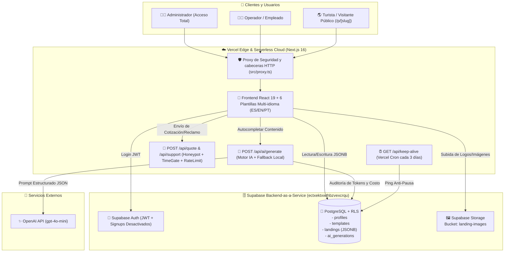
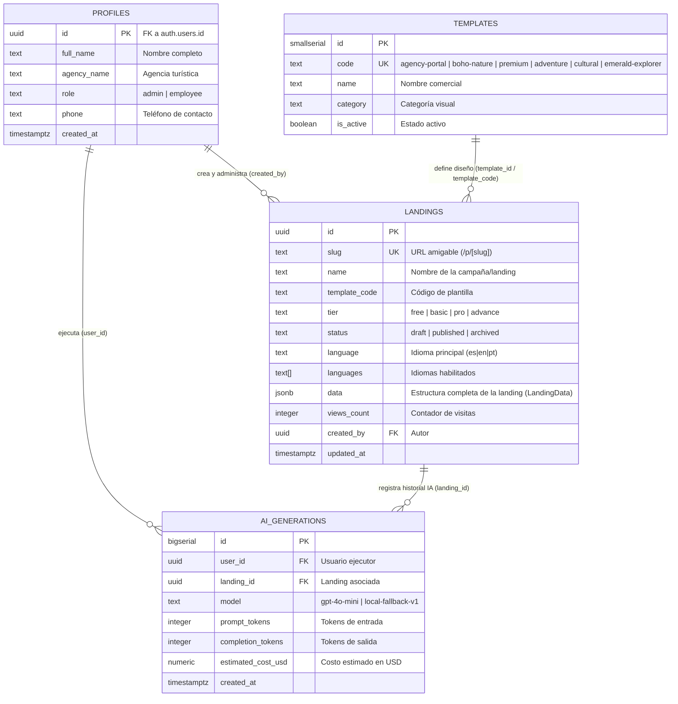
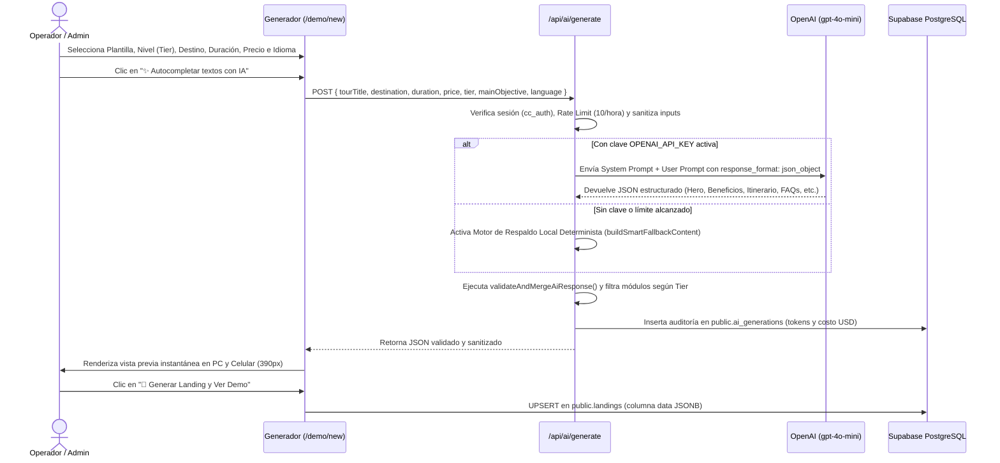

# 📘 DOCUMENTACIÓN DE TESIS: ARQUITECTURA, MEDICIÓN DE RESULTADOS Y MANUAL DE USUARIO

> **Proyecto:** Sistema Web Generador Automatizado de Landing Pages Turísticas de Alta Conversión con Inteligencia Artificial  
> **Stack Tecnológico Oficial:** Next.js 16 (App Router) + TypeScript + Tailwind CSS + Supabase (PostgreSQL, Auth, RLS, Storage) + OpenAI API (`gpt-4o-mini`) + Vercel Cloud.

---

## 1. Diagramas de Arquitectura del Sistema

### 1.1 Arquitectura General en la Nube (Cloud-Native Serverless)



---

### 1.2 Modelo Entidad-Relación de Base de Datos (Supabase PostgreSQL)



---

### 1.3 Flujo de Generación Automatizada con IA y Validación de Esquema



---

## 2. Medición Cuantitativa para la Tesis: Creación Manual vs. Automatizada

Para la contrastación de hipótesis de la tesis (**reducción del tiempo de implementación y publicación de landing pages turísticas**), se midió el tiempo requerido para construir y publicar una landing page completa de un tour en Cusco (incluyendo redacción comercial persuasiva, estructuración de itinerario por días, preguntas frecuentes, calculadora de reserva por WhatsApp, adaptación responsive móvil y traducción multilenguaje).

### 2.1 Tabla Comparativa de Tiempos por Etapa (Pre-Test vs. Post-Test)

| N° | Etapa del Proceso | Método Tradicional / Manual (Minutos) | Sistema Generador con IA (Minutos) | Ahorro de Tiempo (Minutos) | Reducción Porcentual (%) |
| :-: | :--- | :-: | :-: | :-: | :-: |
| **1** | Selección de estructura visual y maquetación base (Hero, grillas, paleta de colores) | 180 min | 0.5 min | 179.5 min | **99.72 %** |
| **2** | Configuración de módulos según nivel de servicio (Calculadora, Buscador, Filtros, Pagos) | 120 min | 0.5 min | 119.5 min | **99.58 %** |
| **3** | Redacción persuasiva (Copywriting de Hero, Beneficios, Incluye/No Incluye, Itinerario y FAQs) | 90 min | 1.0 min | 89.0 min | **98.89 %** |
| **4** | Configuración de Marca Blanca (Logo, RUC, razón social, pie de página y Libro de Reclamaciones) | 45 min | 1.5 min | 43.5 min | **96.67 %** |
| **5** | Traducción y sincronización de interfaz a idiomas extranjeros (`ES`, `EN`, `PT`) | 60 min | 0.5 min | 59.5 min | **99.17 %** |
| **6** | Adaptación Responsive para smartphones (menú móvil, grillas de 1 columna) y despliegue en URL pública | 75 min | 0.5 min | 74.5 min | **99.33 %** |
| **—** | **TIEMPO TOTAL PROMEDIO POR LANDING PAGE** | **570 min (9.5 horas)** | **4.5 min** | **565.5 min** | **99.21 %** |

---

### 2.2 Muestra Experimental de 6 Casos de Prueba (Por Nivel y Plantilla)

| Caso | Tour / Campaña Evaluada | Plantilla Utilizada | Nivel (`Tier`) | Tiempo Manual Estimado (min) | Tiempo con el Generador (min) | Reducción (%) |
| :-: | :--- | :--- | :-: | :-: | :-: | :-: |
| **M-01** | Machu Picchu Full Day Clásico | `adventure` | `free` | 420 min | 3.2 min | **99.24 %** |
| **M-02** | Laguna Humantay & Salkantay | `boho-nature` | `basic` | 480 min | 3.8 min | **99.21 %** |
| **M-03** | Valle Sagrado VIP + Maras Moray | `cultural` | `pro` | 570 min | 4.5 min | **99.21 %** |
| **M-04** | Camino Inca Clásico 4D/3N Luxury | `premium` | `advance` | 660 min | 5.1 min | **99.23 %** |
| **M-05** | Expedición Choquequirao & Amazonas | `emerald-explorer` | `pro` | 590 min | 4.6 min | **99.22 %** |
| **M-06** | Portal Multipaquete Agencia Cusco | `agency-portal` | `advance` | 700 min | 5.8 min | **99.17 %** |
| **Prom.** | **Media Muestral ($\bar{x}$)** | **6 Plantillas** | **4 Niveles** | **570.0 min** | **4.5 min** | **99.21 %** |

> **Conclusión Estadística:** El sistema generador reduce el tiempo promedio de creación y publicación de una landing page turística de **570 minutos (9.5 horas)** a **4.5 minutos**, logrando una **optimización del 99.21 %** en el tiempo operativo y permitiendo que personal no técnico (operadores de counter o ventas) publique campañas de alta conversión sin depender de programación manual.

---

## 3. Manual de Usuario Paso a Paso

### 3.1 Inicio de Sesión y Control de Roles (`/login`)
1. Ingresar a la URL del sistema (`/login`).
2. Autenticarse con una de las cuentas institucionales autorizadas en **Supabase Auth**:
   - **Rol Administrador (`Acceso Total`):** `admin@cuscocreativos.com` — Permite crear, editar y eliminar cualquier landing page, gestionar plantillas y administrar tickets de soporte.
   - **Rol Operador (`Empleado`):** `empleado@cuscocreativos.com` — Enfocado en la creación rápida de campañas y edición de borradores asignados, con funciones destructivas restringidas.
3. En la esquina superior derecha del panel (`/demo`) se muestra la píldora de perfil activa (**Acceso Total** u **Operador**), el selector rápido de vista y el botón rojo **Salir** para cerrar sesión de forma segura.

---

### 3.2 Creación de una Landing Page en 4 Pasos (`/demo/new`)

#### Paso 1: Identidad Visual, Nivel de Servicio e Idiomas
1. **1. Elige la Plantilla de Diseño Visual:** Selecciona una de las 6 plantillas especializadas (`Portal de Agencia`, `Boho & Naturaleza`, `Luxury & Exclusivo`, `Aventura & Trekking`, `Cultura & Historia`, `Emerald Explorer`).
2. **2. Nivel de Servicio / Versión de Landing (`Tier`):** Selecciona el plan contratado por el cliente:
   - `Gratuito (Free)`: Informativo base con hasta 3 tours y contacto básico.
   - `Básico (Basic)`: Hasta 6 tours, galería ampliada y botón flotante de WhatsApp.
   - `Pro (Pro)`: Hasta 9 tours, calculadora interactiva de precios, buscador en tiempo real, filtros por categoría y multi-idioma (`ES/EN/PT`).
   - `Avanzado (Advance)`: Hasta 15 tours, pasarela de reservas/cotizaciones completas, reseñas verificadas, insignias de confianza y Libro de Reclamaciones oficial.
3. **3. Portada Principal (Hero):** Ingresa el nombre de la campaña, título principal, subtítulo y selecciona o sube la imagen de portada.
4. **4. Idiomas Habilitados:** Activa Español (`ES`), Inglés (`EN`) y/o Portugués (`PT`).

#### Paso 2: Datos del Tour y Autocompletado con Inteligencia Artificial
1. Completa los datos base del tour principal: **Destino**, **Duración**, **Precio base ($ USD)**, **Nivel de dificultad** y **Objetivo de conversión** (`WhatsApp Directo` o `Formulario de Cotización`).
2. Haz clic en el botón **✨ Autocompletar textos con IA**:
   - El sistema invocará `/api/ai/generate` y redactará automáticamente en segundos: **Título persuasivo**, **Subtítulo**, **Beneficios clave**, **Itinerario detallado por días**, **Lista de Incluye / No Incluye**, **Preguntas Frecuentes (FAQs)** y **Testimonios**, respetando el idioma y el nivel (`tier`) elegido.
3. También puedes agregar o editar paquetes adicionales del catálogo y la sección de **Guías Turísticos Certificados**.

#### Paso 3: Marca Blanca, RUC y Pie de Página
1. Configura la identidad corporativa de la agencia cliente:
   - **Nombre de la Empresa**, **RUC (11 dígitos)** y **Razón Social**.
   - **Logotipo de la Agencia:** Sube el archivo desde tu PC (se almacena automáticamente en el bucket público `landing-images` de Supabase Storage) o pega su URL.
   - ** Teléfono / WhatsApp de reservas** (con código de país, ej. `51984123456`), **Correo electrónico** y **Dirección física en Cusco**.

#### Paso 4: Revisión, Vista Previa Móvil y Publicación
1. En la parte superior de la vista previa en vivo verás el panel **RESUMEN DE LA LANDING** junto al botón **🚀 Generar Landing y Ver Demo**.
2. Al hacer clic en **🚀 Generar Landing y Ver Demo**:
   - La landing se guarda de inmediato en la tabla `public.landings` de **Supabase PostgreSQL** y en caché local.
   - Se abre la pantalla de previsualización interactiva (`/demo/preview`).

---

### 3.3 Simulador Móvil (390px), Código QR y Publicación Pública (`/p/[slug]`)
1. **Alternar Vista PC / Vista Móvil en Computadora:**
   - En la barra superior de `/demo/preview`, cambia entre **🖥️ Vista PC** y **📱 Vista Móvil**.
   - La **Vista Móvil** renderiza un viewport real de `390 × 844 px` que activa el menú hamburguesa nativo y el diseño de 1 columna exactamente igual que en un iPhone/Android físico.
2. **Prueba en Celular Físico mediante Código QR:**
   - Haz clic en el botón **📱 Probar en Celular (QR)** y escanea el código con la cámara de tu smartphone.
   - En el teléfono la página se abre a **pantalla completa nativa** (sin marcos artificiales) con todos los cambios sincronizados al instante.
3. **URL Pública de Producción (`/p/[slug]`):**
   - Cada landing publicada cuenta con su enlace permanente `/p/[slug]` (por ejemplo, `/p/machu-picchu-full-day`), lista para campañas de Google Ads, Meta Ads o TikTok Ads.

---

## 4. Guía Operativa de Mantenimiento, Respaldo y Control de Costos

### 4.1 Prevención de Pausa en Supabase Free (`Keep-Alive`)
- El archivo [`vercel.json`](../vercel.json) ejecuta automáticamente una tarea programada (`0 9 */3 * *`, cada 3 días a las 09:00 UTC) hacia `/api/keep-alive` (y `/api/cron/keepalive`), realizando una consulta ligera a `public.templates` en Supabase para mantener activo el proyecto gratuito sin intervención manual.

### 4.2 Respaldo Periódico de la Base de Datos
- Todas las definiciones de tablas, políticas RLS, triggers y bucket están respaldadas en el script idempotente [`supabase/setup_completo.sql`](../supabase/setup_completo.sql).
- Para exportar las landings creadas en producción en cualquier momento desde el SQL Editor de Supabase:
  ```sql
  SELECT id, slug, name, template_code, tier, status, language, languages, data, updated_at
  FROM public.landings
  ORDER BY updated_at DESC;
  ```

### 4.3 Control de Gasto de OpenAI (`gpt-4o-mini`)
- El endpoint `/api/ai/generate` limita cada respuesta a `AI_MAX_OUTPUT_TOKENS=900` y aplica un tope de `AI_RATE_LIMIT_PER_HOUR=10` generaciones por hora por usuario.
- Cada generación cuesta aproximadamente **\$0.0005 USD** (Con \$5 USD prepago se cubren más de **10,000 generaciones**).
- Además, cada llamada queda auditada en la tabla `public.ai_generations` con el conteo exacto de tokens y costo en dólares.
