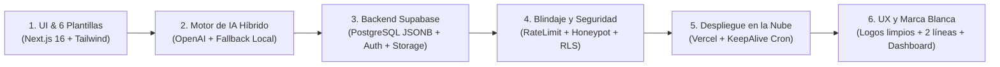

# 🗺️ HOJA DE RUTA Y REGISTRO DE DESARROLLO (ROADMAP EJECUTADO)

> **Proyecto:** Generador Web Automatizado de Landing Pages Turísticas de Alta Conversión con Inteligencia Artificial  
> **Estado:** 100% Completado, desplegado en la nube y verificado.  
> **Repositorio Oficial:** `https://github.com/erikvlad1111-ctrl/Generador-de-Landingpages` (rama `main`)  
> **Despliegue de Producción (Vercel):** `https://generador-de-landingpages.vercel.app`  
> **Base de Datos & Backend (Supabase):** Proyecto `ectxektxwthbzvexcrqu` (PostgreSQL + Auth + Storage + RLS)

---

## 🧭 Resumen de la Ruta de Desarrollo Ejecutada

---

## 📍 Detalle de Fases Implementadas

### Fase 1: Arquitectura Frontend y Catálogo de 6 Plantillas
- **Framework base:** Next.js 16 (App Router) con React 19 y TypeScript.
- **6 Plantillas turísticas especializadas de alta conversión:**
  1. `agency-portal` (Diseño 1): Portal institucional multipaquete para agencias formales.
  2. `boho-nature` (Diseño 2): Estilo editorial orgánico, senderismo y naturaleza.
  3. `premium` (Diseño 3): Lujo exclusivo, concierges y viajeros VIP.
  4. `adventure` (Diseño 4): Trekking de alta montaña, altimetría y domos de cristal.
  5. `cultural` (Diseño 5): Turismo histórico, arqueología y patrimonio andino.
  6. `emerald-explorer` (Diseño 6): Expediciones contemporáneas y ecoturismo.
- **Módulos interactivos integrados:** Calculadora de precios dinámica, filtros por categoría, itinerarios por días, testimonios con estrellas, preguntas frecuentes (FAQs), modal de cotizaciones y Libro de Reclamaciones formal.
- **Enfoque Multi-idioma:** Soporte en tiempo real para Español (`ES`), Inglés (`EN`) y Portugués (`PT`).

---

### Fase 2: Motor de Inteligencia Artificial Híbrido
- **Ruta de Backend:** `POST /api/ai/generate` ejecutada del lado del servidor (ocultando claves API).
- **Generación estructurada:** A partir de datos básicos (Título, Destino, Duración, Precio y Nivel), la IA redacta:
  - Títulos persuasivos y subtítulos de venta.
  - Itinerario detallado desglosado día a día.
  - Lista de Incluye y No Incluye adaptada a la normativa turística.
  - Preguntas frecuentes relevantes para el turista extranjero.
- **Doble Motor (Cero Dependencia de Pagos):**
  - **Motor Primario:** OpenAI (`gpt-4o-mini`) con validación estricta de esquema JSON.
  - **Motor Determinista de Respaldo Local:** Si no hay saldo o falla la red, el sistema genera contenido profesional completo de forma instantánea y con costo \$0.
- **Control de gasto:** Auditoría de tokens en la tabla `public.ai_generations` y límite horario anti-abusos (`AI_RATE_LIMIT_PER_HOUR=25`).

---

### Fase 3: Persistencia en la Nube con Supabase
- **Script Maestro Idempotente:** `supabase/setup_completo.sql` ejecutado en el proyecto `ectxektxwthbzvexcrqu`.
- **Estructura Híbrida Relacional + JSONB:**
  - `public.landings`: Almacena metadatos clave (`slug`, `name`, `template_code`, `tier`, `status`) y el objeto completo del diseño en `data` (JSONB).
  - `public.templates`: Catálogo maestro de plantillas.
  - `public.profiles`: Perfiles de usuario vinculados a `auth.users`.
  - `public.ai_generations`: Historial de consumo y costos de IA.
- **Supabase Storage:** Creación del bucket público `landing-images` para la subida de logotipos corporativos y fotos de tours vía CDN.
- **Sincronización:** `src/data/landingStore.ts` sincroniza lectura y escritura con Supabase en tiempo real, manteniendo `localStorage` como caché ultrarrápido.

---

### Fase 4: Autenticación, Roles y Blindaje de Seguridad
- **Control de Acceso Basado en Roles (RBAC):**
  - **Administrador (`admin`):** Acceso total para crear, editar, publicar y eliminar landings, gestionar tickets y exportar.
  - **Empleado (`employee`):** Acceso enfocado en creación rápida y edición de borradores.
- **Cuentas corporativas oficiales en Supabase Auth:**
  - `admin@cuscocreativos.com` / `CuscoCreativos2026!`
  - `empleado@cuscocreativos.com` / `OperadorCusco2026!`
  - Registro público cerrado (`disable_signup = true`) para evitar accesos no autorizados.
- **Defensas perimetrales implementadas:**
  - Protección de rutas `/demo/*` mediante `src/proxy.ts` (Next.js 16).
  - Rate Limiting en login: bloqueo por 60 segundos tras 5 intentos fallidos consecutivos.
  - Filtro Honeypot invisible en todos los formularios para neutralizar bots automáticos.
  - Campo de contraseña en `/login` estrictamente oculto (`••••••••`) sin botones de revelado.

---

### Fase 5: Experiencia de Usuario (UX), Vista Móvil y Marca Blanca
- **Generador en 4 pasos (`/demo/new`):** Flujo guiado con preview en vivo antes de publicar.
- **Simulador Móvil Real en PC:** Ventana de previsualización con viewport nativo de `390px` (menú hamburguesa real y diseño de 1 columna).
- **Prueba en Celular Físico mediante QR:** Generación de código QR dinámico para abrir la landing en pantalla completa en cualquier smartphone.
- **Perfeccionamiento de Marca Blanca (White-Label):**
  - Contenedores de logotipos limpios: sin fondos blancos artificiales ni marcos tipo estampilla.
  - Adaptabilidad de nombres de empresa largos (3 o 4 palabras) con salto inteligente a 2 líneas en la barra de navegación para evitar descuadres en el menú.
  - Panel principal (`/demo`) con visualización del logo real de la empresa y nombre corporativo destacado sobre cada tour.

---

### Fase 6: Despliegue en Producción y Operación Continua
- **Hosting en Vercel:** Conectado al repositorio de GitHub con despliegues automáticos por commit.
- **Mecanismo Anti-Pausa (Keep-Alive):** Vercel Cron programado cada 3 días hacia `/api/keep-alive` para evitar que el proyecto gratuito de Supabase entre en pausa por inactividad.
- **Variables de Entorno:** Sincronizadas entre `.env.local` y Vercel (`NEXT_PUBLIC_SUPABASE_URL`, `NEXT_PUBLIC_SUPABASE_ANON_KEY`, `SUPABASE_SERVICE_ROLE_KEY`, `CRON_SECRET`, etc.).

---

## 📁 Estructura Clave de Archivos del Proyecto

| Ruta | Propósito |
| :--- | :--- |
| `src/templates/*` | Las 6 plantillas de alta conversión (`Adventure`, `AgencyPortal`, `Boho`, `Cultural`, `ModernEmerald`, `Premium`). |
| `src/app/demo/new/page.tsx` | Asistente de 4 pasos para la creación de nuevas landings con autocompletado IA. |
| `src/app/demo/page.tsx` | Panel principal de administración con vista en tabla y tarjetas, búsqueda y filtros. |
| `src/app/demo/preview/page.tsx` | Simulador interactivo en PC (390px) y generador de código QR para celular. |
| `src/app/p/[slug]/page.tsx` | Renderizador público de la landing en producción con lectura desde Supabase. |
| `src/app/api/ai/generate/route.ts` | Motor de backend para IA (OpenAI + Fallback local determinista + auditoría). |
| `src/data/landingStore.ts` | Capa de abstracción de datos (Sincronización Supabase PostgreSQL + caché). |
| `src/lib/supabase.ts` | Cliente de conexión a Supabase y función de subida de imágenes a Storage. |
| `supabase/setup_completo.sql` | Script SQL maestro para levantar toda la base de datos en cualquier cuenta de Supabase. |
| `docs/documentacion_tesis.md` | Documentación formal de tesis (Diagramas Mermaid, Medición de Tiempos y Manual). |
| `docs/hoja_de_ruta_proyecto.md` | Esta hoja de ruta con el registro completo de lo implementado. |
